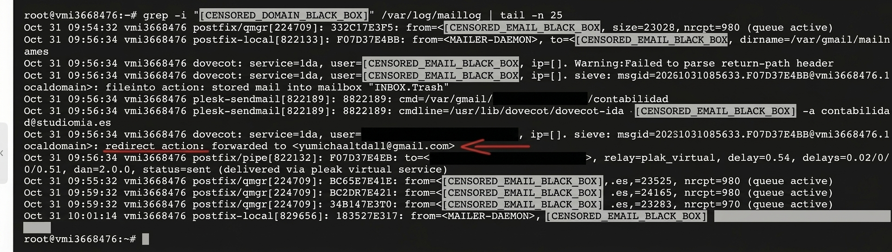
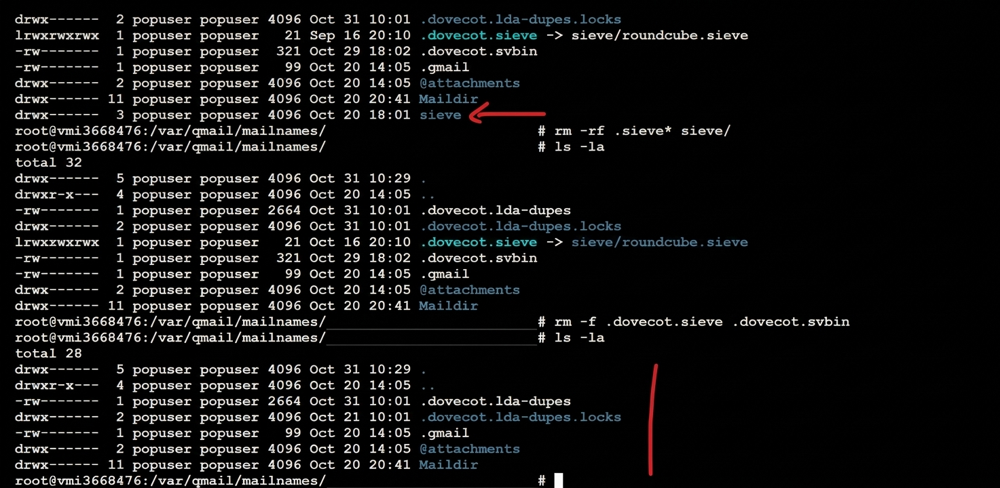

#  Caso de Estudio: Respuesta a Incidentes y Erradicación de Persistencia en Servidor de Correo (Postfix/Dovecot)

##  Resumen del Incidente
Se recibió una alerta crítica del proveedor de infraestructura debido a un volumen inusualmente alto de tráfico SMTP saliente por el puerto 25/tcp. Esto provocó el bloqueo preventivo del puerto y la inclusión de la dirección IP del servidor en varias listas negras públicas de reputación (RBL: Spamhaus, TRUNCATE, NoSolicitado).

* **Entorno del sistema:** Linux (Ubuntu 24.04 LTS) / Plesk Obsidian / Postfix / Dovecot.
* **Vector de ataque:** Tras descartar vectores en la capa web, se confirmó la vulneración de credenciales SMTP de cuentas específicas. Los atacantes inyectaron reglas Sieve maliciosas en Dovecot para exfiltración de correo y amplificación de spam saliente.
* **Impacto:** Inundación de la cola de correo de Postfix, degradación severa de la reputación de la IP y degradación del servicio de envío legítimo.

---

##  Ciclo de Vida de la Respuesta al Incidente (Análisis Forense en Profundidad)

### Fase 1: Endurecimiento Inicial y Auditoría en la Capa de Aplicación Web
Siguiendo la metodología estándar de respuesta a incidentes (Zero Trust), se comenzó por auditar y descartar la presencia de webshells o scripts PHP maliciosos en los sitios alojados:

1. **Endurecimiento de Egresos y Credenciales:** Reducción preventiva del límite de salida a 50 msgs/hora. Cambio masivo de contraseñas de cuentas de correo y usuarios administradores de WordPress.
2. **Escaneo Automatizado de Malware:** Se ejecutó un análisis de firmas a nivel de servidor con ImunifyAV en la raíz web (`/httpdocs/`). Resultado: **LIMPIO**.
3. **Análisis Estático de Código (Manual):** Inspección manual de archivos críticos del sistema de archivos (`wp-config.php`, `index.php`) buscando funciones de ofuscación (`eval()`, `passthru()`) o llamadas `require()` a rutas inusuales. Resultado: **LIMPIO**.
4. **Auditoría de Base de Datos:** Revisión de las tablas de usuarios y opciones de WordPress en busca de administradores no autorizados o inyecciones de código. Resultado: **LIMPIO**.

Dado que la auditoría web resultó totalmente limpia pero la cola de correo continuaba saturándose, el foco de la investigación se trasladó al sistema de correo.

---


### Fase 2: Aislamiento y Detección de la Persistencia
1. **Análisis de Logs del Correo:** Inspección detallada de los registros del sistema (`/var/log/maillog`) filtrando por los agentes de entrega local (LDA/Dovecot):
   ```bash
   grep -i "dominio_afectado" /var/log/maillog | tail -n 25



### **Fase 3: Erradicación y Limpieza de Archivos Ocultos Sieve**

Para eliminar por completo el reenvío malicioso y asegurar que el agente de entrega local (LDA) de Dovecot no ejecutara reglas en caché, se realizó un proceso de purga en dos etapas dentro del directorio del buzón afectado (`/var/qmail/mailnames/dominio_anonimizado/cuenta_anonimizada/`):

#### **1. Purga de Reglas de Usuario y Directorio Sieve (`rm -rf .sieve* sieve/`)**
* **Objetivo:** Eliminar scripts activos de usuario (`.sieve`) y la carpeta contenedora (`sieve/`) donde Webmail/Roundcube guarda las configuraciones del filtro.
* **Comando ejecutado:**
  ```bash
  rm -rf .sieve* sieve/
  

